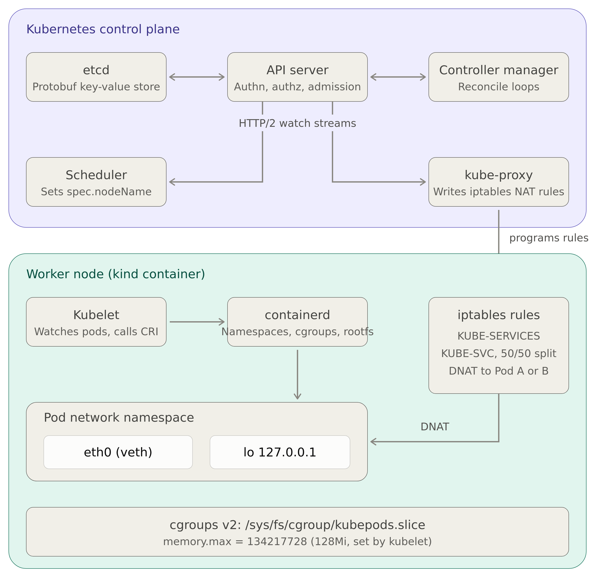

# Kubernetes Deep-Dive: Kernel-Level Load Balancing

> **SRE Revision Guide** — A hands-on walkthrough that tears apart a `kind` cluster to expose the kernel primitives Kubernetes actually uses: etcd storage, CRI containers, cgroups memory limits, controller reconciliation loops, CNI networking, and iptables-based service load balancing.

---

## Architecture Overview



---

## Prerequisites & Cluster Setup

Install **kind** (Kubernetes in Docker) and **kubectl** if not already present, then create a cluster named `deep-dive`.

```bash
# Install kind
curl -Lo ./kind https://kind.sigs.k8s.io/dl/latest/kind-linux-amd64
chmod +x ./kind
sudo mv ./kind /usr/local/bin/kind

# Install kubectl
sudo snap install kubectl --classic

# Create the cluster (idempotent)
kind get clusters | grep -q "deep-dive" || kind create cluster --name deep-dive
```

A helper variable is used throughout to exec into the control-plane node container:

```bash
NODE="docker exec deep-dive-control-plane"
```

---

## Chapter 1 — The API Server & etcd

### Concept

Every `kubectl apply` call is a REST request to the **API Server**. The API server:

1. Authenticates and authorizes the caller.
2. Runs admission controllers.
3. Serializes the object to **Protobuf**.
4. Writes the serialized bytes into **etcd** under a key like `/registry/<resource-type>/<namespace>/<name>`.

```
  kubectl apply ──► API Server ──► Protobuf ──► etcd
                    (REST/HTTP)                 (/registry/...)
```

### Hands-On: Query etcd Directly

Bypass the API server entirely and list raw etcd keys from the control-plane node:

```bash
# Install etcd client on the node
$NODE apt-get update -qq
$NODE apt-get install -y -qq etcd-client

# List the first 10 raw etcd keys
$NODE env ETCDCTL_API=3 etcdctl \
  --endpoints=https://127.0.0.1:2379 \
  --cacert=/etc/kubernetes/pki/etcd/ca.crt \
  --cert=/etc/kubernetes/pki/etcd/healthcheck-client.crt \
  --key=/etc/kubernetes/pki/etcd/healthcheck-client.key \
  get /registry/ --prefix --keys-only | head -n 10
```

> **Key Insight:** The values stored in etcd are Protobuf-encoded — they are *not* the YAML/JSON you see from `kubectl get`. The API Server is the translator.

---

## Chapter 2 — Kubelet, CRI & cgroups

### Concept

When the **Scheduler** assigns a Pod to a node, the **Kubelet** on that node:

1. Calls the **Container Runtime Interface (CRI)** — in kind, this is **containerd**.
2. containerd creates Linux **namespaces** (pid, net, mnt, etc.) and a **cgroup** for resource isolation.
3. The Kubelet configures the cgroup limits (memory, CPU) based on the Pod spec.

```
  Kubelet ──► CRI (containerd) ──► Linux Kernel
                                    ├── Namespaces (pid, net, mnt, uts, ipc)
                                    └── cgroups v2
                                         ├── memory.max = 134217728
                                         └── cpu.max    = ...
```

### Hands-On: Trace from CRI to cgroups

```bash
# Launch a Pod with explicit memory limits
kubectl run deep-dive-nginx --image=nginx \
  --requests=memory=64Mi --limits=memory=128Mi || true
kubectl wait --for=condition=Ready pod/deep-dive-nginx --timeout=30s

# Get the container ID through CRI (not kubectl)
CONTAINER_ID=$($NODE crictl ps --name deep-dive-nginx -q)
echo "[*] CRI Container ID: $CONTAINER_ID"

# Resolve the host PID via CRI inspect
PID=$($NODE bash -c "crictl inspect $CONTAINER_ID \
  | grep -m 1 '\"pid\"' | awk '{print \$2}' | tr -d ','")
echo "[*] Nginx Host PID: $PID"

# Enter the Pod's network namespace directly from the host
echo "[*] Network namespace IP (via nsenter):"
$NODE nsenter -t $PID -n ip -4 a

# Read the raw cgroups v2 memory limit (128Mi = 134217728 bytes)
echo "[*] cgroups v2 memory.max:"
$NODE bash -c 'POD_CGROUP=$(find /sys/fs/cgroup/kubepods.slice/ \
  -name "*deep-dive-nginx*" -type d | head -n 1); \
  cat $POD_CGROUP/memory.max'
```

> **Key Insight:** `nsenter -t <PID> -n` lets you enter a container's network namespace without any container tooling — it's a raw kernel operation.

---

## Chapter 3 — Controllers & Reconciliation

### Concept

Kubernetes controllers are **level-triggered** reconciliation loops. They:

1. **Watch** the API Server over persistent HTTP/2 streams.
2. Compare the **desired state** (Deployment spec) with the **actual state** (running Pods).
3. Take action to converge (create/delete ReplicaSets and Pods).

```
                ┌──────────────┐
                │  Deployment  │ (desired: replicas=2)
                │  Controller  │
                └──────┬───────┘
                       │ watches + reconciles
                       ▼
                ┌──────────────┐
                │  ReplicaSet  │ (owns Pod templates)
                │  Controller  │
                └──────┬───────┘
                       │ creates
               ┌───────┴───────┐
               ▼               ▼
         ┌──────────┐   ┌──────────┐
         │  Pod A   │   │  Pod B   │
         └──────────┘   └──────────┘
```

### Hands-On: Trigger the Loop

```bash
# Create a Deployment with 2 replicas
kubectl create deployment deep-dive-deploy --image=nginx --replicas=2 \
  --dry-run=client -o yaml | kubectl apply -f -
kubectl wait --for=condition=Available deployment/deep-dive-deploy --timeout=30s
```

Watch the event stream in a separate terminal to see the controller reconciliation in real time:

```bash
kubectl get events --watch --output-watch-events
```

---

## Chapter 4 — CNI, kube-proxy & Kernel-Level Load Balancing

### Concept

When you create a **Service**, `kube-proxy` watches the Service and Endpoints objects, then programs **iptables NAT rules** in the kernel. The traffic flow is:

```
  Client ──► ClusterIP:80
                │
    ┌───────────▼──────────────────────────────────┐
    │         KUBE-SERVICES chain (nat table)       │
    │  match: -d <ClusterIP>/32 -p tcp --dport 80  │
    │  action: jump to KUBE-SVC-xxxxx               │
    └───────────┬──────────────────────────────────┘
                │
    ┌───────────▼──────────────────────────────────┐
    │         KUBE-SVC-xxxxx chain                  │
    │  rule 1: -m statistic --probability 0.5       │
    │          jump KUBE-SEP-aaaa                   │
    │  rule 2: jump KUBE-SEP-bbbb                   │
    └───────────┬──────────┬───────────────────────┘
                │          │
    ┌───────────▼───┐  ┌───▼───────────────────────┐
    │ KUBE-SEP-aaaa │  │ KUBE-SEP-bbbb             │
    │ DNAT to       │  │ DNAT to                   │
    │ PodA_IP:80    │  │ PodB_IP:80                │
    └───────────────┘  └───────────────────────────┘
```

The kernel's **statistic** module in iptables implements a pure random load balancer — no userspace proxy is in the data path.

### Hands-On: Trace the iptables Chains

```bash
# Expose the deployment as a ClusterIP Service
kubectl expose deployment deep-dive-deploy --port=80 --target-port=80 \
  --dry-run=client -o yaml | kubectl apply -f -
CLUSTER_IP=$(kubectl get svc deep-dive-deploy -o jsonpath='{.spec.clusterIP}')
echo "[*] Service ClusterIP: $CLUSTER_IP"

# 1. KUBE-SERVICES — intercepts traffic to the ClusterIP
KUBE_SVC_CHAIN=$($NODE iptables-save -t nat \
  | grep "$CLUSTER_IP/32" \
  | grep -o 'KUBE-SVC-[a-zA-Z0-9-]*' | head -n 1)
$NODE iptables-save -t nat | grep "$CLUSTER_IP/32"

# 2. KUBE-SVC — the load balancer chain (50/50 split via statistic module)
$NODE iptables-save -t nat | grep "^-A $KUBE_SVC_CHAIN"

# 3. KUBE-SEP — the endpoint chain applying DNAT to real Pod IPs
KUBE_SEP_CHAIN=$($NODE iptables-save -t nat \
  | grep "^-A $KUBE_SVC_CHAIN" \
  | grep -o 'KUBE-SEP-[a-zA-Z0-9-]*' | head -n 1)
$NODE iptables-save -t nat | grep "^-A $KUBE_SEP_CHAIN" | grep DNAT
```

> **Key Insight:** There is no userspace load balancer. The Linux kernel itself performs the DNAT and probability-based load balancing at wire speed using the `xt_statistic` iptables module.

---

## Full Packet Flow — End to End

```
  curl ClusterIP:80
       │
       ▼
  ┌─────────────────────────────────────┐
  │  PREROUTING chain (nat table)       │
  │  → jumps to KUBE-SERVICES          │
  └──────────────┬──────────────────────┘
                 │
  ┌──────────────▼──────────────────────┐
  │  KUBE-SERVICES                      │
  │  match ClusterIP → KUBE-SVC-xxxx   │
  └──────────────┬──────────────────────┘
                 │
  ┌──────────────▼──────────────────────┐
  │  KUBE-SVC-xxxx                      │
  │  statistic probability 0.50 → SEP-A │
  │  default                   → SEP-B │
  └──────┬───────────────┬──────────────┘
         │               │
  ┌──────▼────┐   ┌──────▼────┐
  │ KUBE-SEP-A│   │ KUBE-SEP-B│
  │ DNAT to   │   │ DNAT to   │
  │ 10.244.x.a│   │ 10.244.x.b│
  └──────┬────┘   └──────┬────┘
         │               │
         ▼               ▼
  ┌─────────────────────────────────────┐
  │  CNI bridge / veth pair routing     │
  │  → packet arrives at Pod container  │
  └─────────────────────────────────────┘
```

---

## Summary

| Chapter | Kernel Primitive       | Kubernetes Abstraction | Proof Command                          |
|---------|------------------------|-----------------------|----------------------------------------|
| 1       | Filesystem (etcd WAL)  | API Server + etcd     | `etcdctl get /registry/ --prefix`      |
| 2       | Namespaces + cgroups   | Kubelet + CRI         | `nsenter`, `cat memory.max`            |
| 3       | HTTP/2 streams         | Controllers            | `kubectl get events --watch`           |
| 4       | iptables / netfilter   | kube-proxy + Service  | `iptables-save -t nat`                 |

---

## Cleanup

```bash
kubectl delete deployment deep-dive-deploy
kubectl delete svc deep-dive-deploy
kubectl delete pod deep-dive-nginx
kind delete cluster --name deep-dive
```
